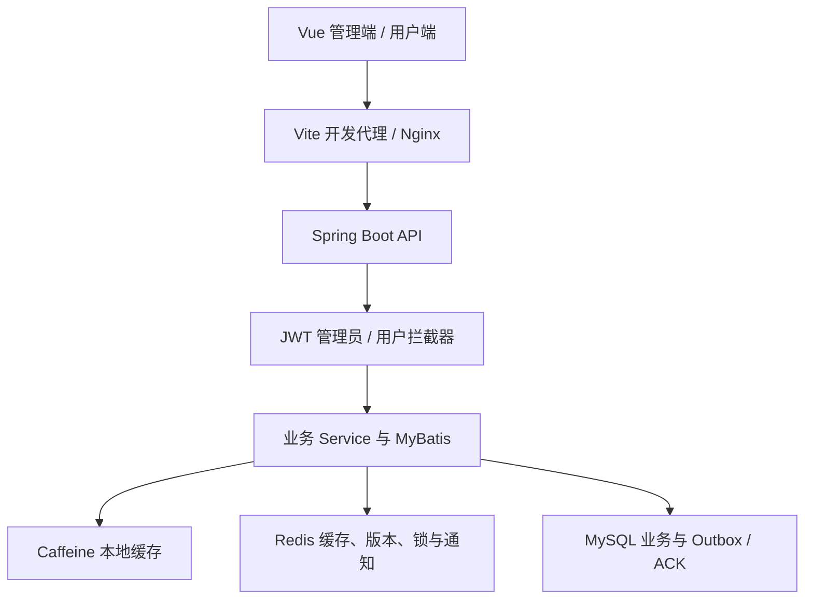
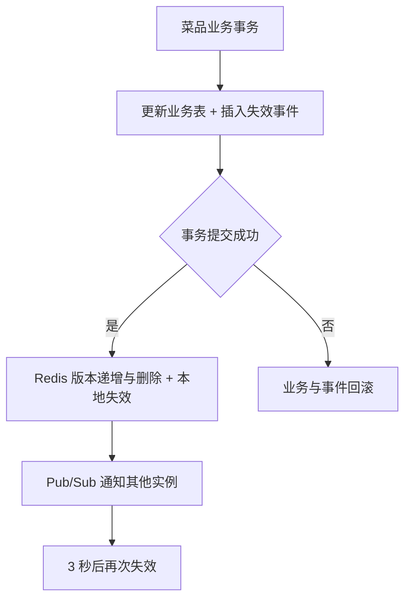
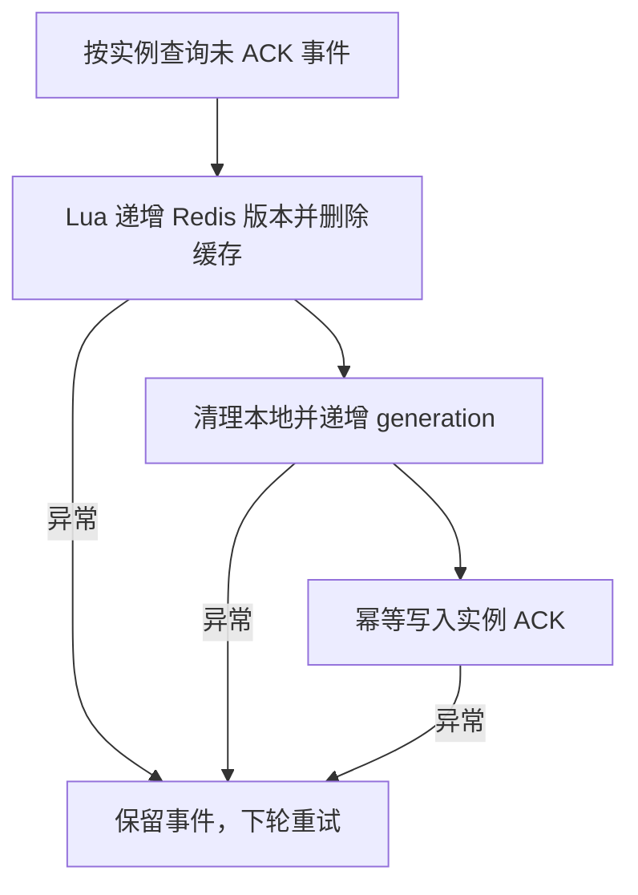

# 系统架构与一致性边界

来源：sky-server 与 sky-admin 当前源码。这里区分已实现流程和仍需运行验收的性质。

## 系统组成

工程采用 controller → service → mapper 的单体分层结构，不是微服务。两个后端实例共享 MySQL/Redis，各自持有 Caffeine、generation 状态、熔断器及降级 Semaphore。图片保存在进程工作目录 uploads；多实例并没有实现共享文件存储。

## 菜品查询

`DishServiceImpl.listByCategoryId` 先验证分类 ID，再读本地 generation/缓存快照。命中直接返回；未命中进入同分类本地锁，二次检查后加载 Redis/MySQL。结果只有在 generation 未改变时才可写入本地缓存，最多重试 3 次。

Redis 未命中时尝试 `SET NX`，锁 TTL 30 秒；获取锁后二次读取缓存，并读取或初始化版本号。查询数据库后，以 Lua 在同一原子操作中比较版本并写缓存及 TTL。版本变化则重新查询，最多 3 次。解锁脚本核对随机所有者值；没有锁续租。同分类竞争默认 40 次、每次间隔 50ms，耗尽后返回业务错误。

| Redis Key | 用途 |
|---|---|
| sky:dish{categoryId} | 当前分类 JSON，例如 sky:dish1；注意实际代码前缀没有额外冒号 |
| sky:dish:version:{categoryId} | 版本号，不设 TTL |
| lock:sky:dish{categoryId} | 重建租约锁 |
| sky:cache:invalidate:dish | Pub/Sub 频道，只传分类 ID |

## 写入与补偿

`evictDishCacheAfterCommit` 要求有效事务，事件插入失败会抛异常使业务回滚。Pub/Sub Listener 仅清理本地并递增 generation，不写 ACK。即时失效也不写 ACK；每实例 ACK 来自 Poller。

Poller 每轮最多处理 100 条，完成一轮后等待 2 秒。实际延迟包括启动等待、排队、执行和故障恢复，不能承诺 2 秒内必定完成。每个实例都会重复执行 Redis 失效，ACK 唯一性不等于全流程只执行一次。重复失效可能增加版本和降低命中率，但不是重复业务写入。

清理任务每小时运行，启动后首次等待 60 秒；仅删除早于 7 天且全部预期实例确认的事件。实例永久退役需人工维护预期集合；不应因临时离线删除其 ID。新实例上线需先加入所有实例的预期集合，并验证补偿完成后再承担流量。结构缓存已确认 ACK 联合主键；未记录外键，实际存量表仍须核查 ON DELETE CASCADE，所附迁移尚未执行。

## 故障和一致性边界

当前方案属于最终一致性设计：MySQL 提交到缓存失效存在窗口，Pub/Sub 丢失依赖轮询补偿。Lua 防止被观察到的版本变更后旧查询覆盖 Redis；generation 保护已被本地观察到的失效。它们不能消除“其他实例尚未收到失效”的时间窗口。

Redis 读取异常可触发 Resilience4j，降级最多允许每实例 5 个数据库查询并发，超过上限立即返回业务错误。然而本地命中发生在 Redis 操作之前；Redis 故障时，远端实例可能继续返回本地旧值。Poller 在 Redis 失败时也不会清理本地或 ACK。该行为尚未修复、未完成故障测试。

Caffeine 状态映射 `states` 不随缓存驱逐而回收，任意正分类 ID 会创建本地状态，存在长期增长风险。重建数据还会按菜品逐项读取口味，存在 N+1 查询；未做性能优化或测量。当前多 Key Lua 未采用 Redis Cluster 哈希标签，交付目标为单 Redis 服务。

相关代码：`service/impl/DishServiceImpl.java`、`cache/DishLocalCacheManager.java`、`cache/CacheInvalidationPoller.java`、`mapper/CacheInvalidationAckMapper.java`、`config/CacheInvalidationEventCleanupJob.java`。
