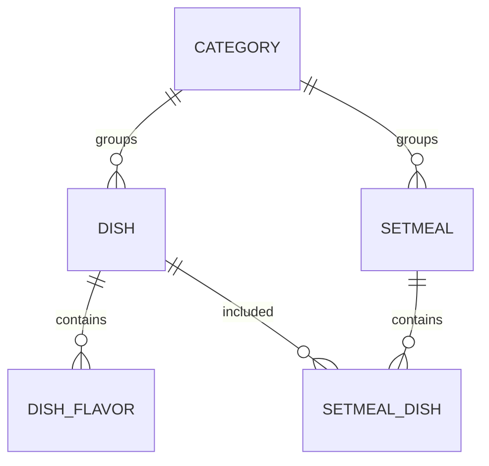
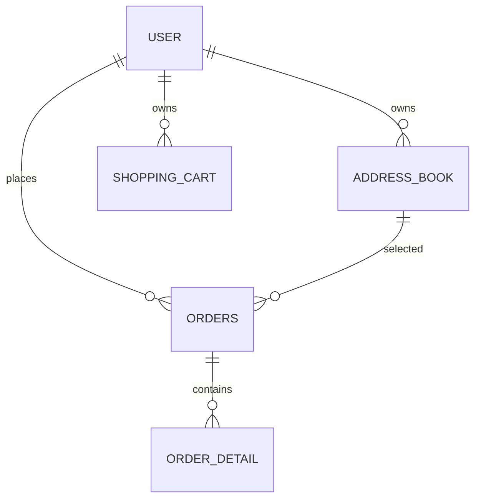
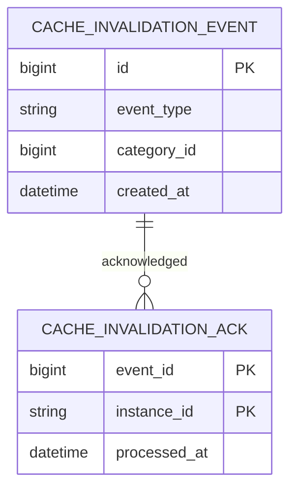

# 数据库设计与初始化边界

原源码包的 SQL 只有 employee 表；后补的 sky_ds.zip 包含 IDEA 的数据库结构缓存，不是 SQL 备份。已从中提取 sky_take_out 的 **13 张表、117 列和 17 个索引**，生成对应的空库建表脚本，并以 schema-cache.json 保存项目表的规范化结构。缓存文件时间标记为 2026-11-11 16:44（时区未知），当前实时结构仍需 SHOW CREATE TABLE 确认。未复制连接账号或其他数据库信息；未执行 MySQL 建表及 Mapper 集成验证。详见 [附件核对](source-review.md)。

## 表清单

| 表 | 用途 | 主要关联 |
|---|---|---|
| employee | 商家员工与 BCrypt 登录密码 | 业务审计 create_user/update_user 为可选逻辑关联 |
| category | 菜品/套餐分类 | type=1 菜品，type=2 套餐 |
| dish | 菜品基本信息 | category_id |
| dish_flavor | 菜品口味 | dish_id |
| setmeal | 套餐 | category_id |
| setmeal_dish | 套餐组成与展示快照 | setmeal_id、dish_id |
| user | 用户与模拟 openid | 缓存中 openid 无唯一索引 |
| address_book | 收货地址 | user_id |
| shopping_cart | 当前用户购物车 | user_id、dish_id 或 setmeal_id |
| orders | 订单主表与配送/收货快照 | user_id、address_book_id |
| order_detail | 下单商品快照 | order_id、dish_id 或 setmeal_id |
| cache_invalidation_event | 持久化失效事件 | category_id 为事件载荷 |
| cache_invalidation_ack | 各实例处理确认 | event_id + instance_id 联合主键 |

## 商品关系



## 交易关系



业务关系均为逻辑关系，脚本未施加物理外键，以保持现有删除流程与历史快照；服务层需承担归属、状态、引用检查。购物车/明细中的菜品和套餐引用为二选一，脚本未添加 CHECK 约束，业务校验仍需运行验收。

## 事件关系



此图表示事件与 ACK 的逻辑关系。缓存确认了 ACK 联合主键，却没有外键记录，不能宣称现有库已支持级联。基础脚本忠实保留该观察结果；另附 `sql/migrations/001_ack_event_cascade.sql`，供新库在基础建表后执行一次，为当前仅删除事件的清理代码补充物理外键与 ON DELETE CASCADE。存量库先检查现有约束和孤儿 ACK 再决定迁移。未处理实例的事件仍需保留，不随单次 Pub/Sub 发送成功而删除。

## 字段与索引设计

完整列定义见 `../../sql/sky_take_out.sql`。字段类型、长度、NULL 和默认值来自缓存；金额为 DECIMAL(10,2)，业务时间主要是 DATETIME，Outbox/ACK 时间是 DATETIME(3)。业务表使用 utf8mb4_unicode_ci，事件与 ACK 使用 utf8mb4_0900_ai_ci，因此目标需 MySQL 8。空库脚本不保留原表的自增计数位置，也不包含数据。

缓存里 17 个索引包括：13 个表主键、employee.username 唯一索引、事件表的 idx_category_id_id / idx_created_at，以及 ACK 的 idx_instance_processed。没有观察到用户 openid 唯一键，也没有菜品分类、订单查询或购物车的额外业务索引。没有把建议索引写成已经实现的优化；后续应以实际查询 EXPLAIN 和负载结果决定。

ACK 主键为 (event_id, instance_id)，重复 ACK 使用 ON DUPLICATE KEY 的无操作更新，不应改变首次 processed_at。事件类型/ID 扫描与 NOT EXISTS 查询仍需运行期执行计划验收。

## 新库与旧库

新库：先创建隔离的开发数据库，再导入基础脚本并执行 ACK 外键迁移，用本地生成的 BCrypt 哈希初始化管理员。无演示业务数据，分类、菜品、套餐需通过管理端录入，不能假设 categoryId=1 已存在。

旧库：**不要直接重跑建表脚本**。先备份，并逐表比较 SHOW CREATE TABLE，特别是事件/ACK 的联合主键、外键、默认时间与索引。基础脚本不会自动补齐既有表；所附外键迁移不能对未检查的旧库盲目执行。SQL 中无 DROP/TRUNCATE；CREATE TABLE 遇到同名表会报错，需要按实际差异编写迁移。

## 可用的验收查询

```sql
SHOW CREATE TABLE cache_invalidation_event;
SHOW CREATE TABLE cache_invalidation_ack;
SELECT event_id, instance_id, COUNT(*) total
FROM cache_invalidation_ack
GROUP BY event_id, instance_id HAVING COUNT(*) > 1;
SELECT e.id, e.category_id, a.instance_id, a.processed_at
FROM cache_invalidation_event e
LEFT JOIN cache_invalidation_ack a ON a.event_id=e.id
ORDER BY e.id DESC LIMIT 50;
```

这些查询仅为待执行检查，不构成已通过结论。
